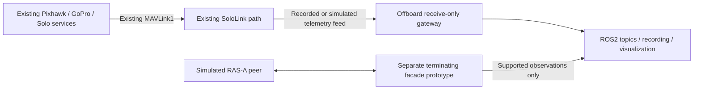

# ROS 2 and RAS-A investigation for OpenSolo

Research date: 29 October 2026. Scope: public primary-source research and local documentation reads. No software integration, builds, tests, package installations, hardware access, firmware changes, source-lock changes or publication occurred. All new files are contained in this investigation directory. Facts below are attributed; recommendations and engineering deductions are explicitly identified as such.

## Findings that affect the decision

**Recommendation: evaluate ROS 2 offboard first, through a receive-only MAVLink gateway, and treat RAS-A as a separate interoperability workstream.** The existing OpenSolo control and video paths should remain the product baseline. This offers ROS visualization, recording and later application integration without making the controller carry an unmeasured middleware workload. A full RAS-A interface would require a deliberate compatibility facade, capability mapping and qualification against an actual peer.

RAS-A means **Robotics and Autonomous Systems – Air**. The authoritative public document is the *RAS-A MAVLink Control Link Interoperability Profile*, release 1.2, dated 19 May 2023. AIR IOP is the air-vehicle interoperability profile reflected by the repository's name; the examined material does not establish a separate protocol or a different expansion for AIR. [Public RAS-A profile](https://support.skydio.com/hc/article_attachments/28759364986907).

| Technology | Role | Consequence for OpenSolo — engineering assessment |
|---|---|---|
| ROS 2 | Framework for nodes, typed topics, services, actions and tools | Useful for applications, diagnostics, recording and integration outside the existing flight-control boundary. |
| DDS / RTPS | Common ROS 2 middleware and network representation, selected through RMW | Adds discovery, serialization and configurable delivery behavior; does not interpret MAVLink packets. |
| MAVLink | Framing, message schemas and higher-level drone exchanges | The existing hardware contract stays MAVLink 1 where required. A modern Python package version does not itself change that contract. |
| `ras_a.xml` | Additional MAVLink definitions with inherited message sets | Supplies vocabulary; implementing an interface also needs behavior, identity and capability ownership. |
| RAS-A / AIR IOP | A profile governing interoperable air-vehicle interfaces | Requires a project-level compatibility target and a peer, rather than a dependency toggle. |

The ROS project describes its DDS architecture and separation of middleware concerns; MAVLink documents its v1/v2 differences. These are independent protocol systems. [ROS DDS design](https://design.ros2.org/articles/ros_on_dds.html), [MAVLink 2 guide](https://mavlink.io/en/guide/mavlink_2.html).

## Normative profile: compact requirements record

The profile states:

- **R1:** joint services manage the IOP; Dronecode governs underlying MAVLink; the Joint Program Office manages the document.
- **R2:** v1.2's message-set authority is commit `67e4ebc74144246f292b8229798d7e4f7360ecd8`.
- **R3:** use MAVLink 2 over IPv4/UDP; identify peers by IP/port, send telemetry by multi-unicast, and leave routing to IP rather than forwarding between participants.
- **R4:** listen on UDP14550; exchange nominal 1Hz heartbeats; five missed heartbeats break a connection.
- **R5:** required capabilities include integer/float missions, integer commands, parameter encodings, flight termination and MAVLink2.
- **R6:** signing is optional under the selected encrypted datalink assumption; compatible datalinks require AES-256 by default.
- **R7:** the scope includes pairing, payloads, camera/gimbal control and optional exploration. Video uses H.264 and MISB ST0804.4 packaging; optional KLV metadata follows ST0601.18.

These are summaries of printed pages3,12–15,27–30; the complete profile governs interpretation. [RAS-A v1.2 PDF](https://support.skydio.com/hc/article_attachments/28759364986907).

**Deductions from R1–R7:** a telemetry adapter can be valuable without claiming compliance. Full conformance cannot be inferred from decoding packets. An OpenSolo facade would terminate one protocol relationship and represent the vehicle deliberately, rather than act as a transparent cross-protocol router. Flight termination is a particularly consequential gap to assess; do not manufacture capability advertisements. Existing Wi-Fi pairing, ordinary unsigned telemetry, H.264 support or an IP address alone do not establish conformity. Distinguish transport security from authentication of the application peer.

## Linked repository: exact contents and maturity

The repository is a public fork of `mavlink/mavlink`, created in September2021. The GitHub API reports master `13cf514dec6db8e67e747360e10e0670095f2221`, whose latest commit is dated 7 September2023. Repository `pushed_at` is 19 March2025, which must not be mistaken for a 2025 master implementation update. It is not archived. Saved API evidence includes repository metadata, branches, releases, tags and recent/path-specific commits. [Repository API](https://api.github.com/repos/Dronecode/air-iop-definitions), [master commit](https://github.com/Dronecode/air-iop-definitions/commit/13cf514dec6db8e67e747360e10e0670095f2221).

The published release records are v1.1 on 2 November2022 and v1.2 on 14 August2023. The latter points to `67e4ebc74144246f292b8229798d7e4f7360ecd8`; it says its definitions belong to profile v1.2. These publication dates differ from the profile's document dates. No newer release was returned by the API during this investigation. That establishes the public release state of this repository, not the absence of later private/government work. [v1.2 release](https://github.com/Dronecode/air-iop-definitions/releases/tag/v1.2-ras-a_iop), [release API](https://api.github.com/repos/Dronecode/air-iop-definitions/releases).

`ras_a.xml` includes `development.xml`, which includes `common.xml` and ultimately the minimal definitions. The file adds ten enum blocks, eleven `MAV_CMD` entries and four messages: `POI_REPORT`51000, `EXPLORATION_STATUS`51100, `EXPLORATION_INFO`51101 and `EXPLORATION_RETURN_POSITION`51102. Commands describe portal traversal, exploration, POI focus/follow and component control. They provide no navigation, perception or control implementation. Capability flags describe obstacle avoidance/VIO/exploration, not algorithms that produce those capabilities. The XML directory name `v1.0` is not a requirement to use MAVLink1 framing. [Pinned dialect](https://github.com/Dronecode/air-iop-definitions/blob/13cf514dec6db8e67e747360e10e0670095f2221/message_definitions/v1.0/ras_a.xml), [inherited development definitions](https://github.com/Dronecode/air-iop-definitions/blob/13cf514dec6db8e67e747360e10e0670095f2221/message_definitions/v1.0/development.xml).

**A concrete version trap:** v1.2 assigns `MAV_TYPE_GENERIC_COMPONENT`43. Master assigns50, changed to resolve a collision with an upstream multirotor type. This is the sole textual difference between the two `ras_a.xml` files downloaded here; inherited files also require their own pinned revisions. Identical message framing would not prevent peers disagreeing about that heartbeat enum. Do not silently mix a release dialect with modern upstream XML or replace OpenSolo's current dialect globally. Record any peer-specific exception and negotiate/document semantics. [Released dialect](https://github.com/Dronecode/air-iop-definitions/blob/67e4ebc74144246f292b8229798d7e4f7360ecd8/message_definitions/v1.0/ras_a.xml), [collision-fix commit](https://github.com/Dronecode/air-iop-definitions/commit/cd042287a23261ae5eb2b4a5fe5866959940d8b6).

The generator submodule is **Dronecode/pymavlink**, not simply an unqualified current upstream install, pinned at `1de471e00efae577941a1f1a35b00e2ec1803e6f`. CMake defaults to `common`, accepts `MAVLINK_DIALECT=ras_a`, defaults to protocol2.0, and invokes pip with `--upgrade` during generation. It is a dependency workflow to redesign for a reproducible Yocto experiment, not a recipe to execute directly in the product. Generated C consumers need headers; the Python generator does not have to run on target. [Submodule declaration](https://github.com/Dronecode/air-iop-definitions/blob/13cf514dec6db8e67e747360e10e0670095f2221/.gitmodules), [CMake source](https://github.com/Dronecode/air-iop-definitions/blob/13cf514dec6db8e67e747360e10e0670095f2221/CMakeLists.txt).

CI describes XML formatting, Python3.7–3.11 and old Node matrices, plus a `ras_a` C example build. Its deployment script generates C, C++ and Java repositories. These are generation/compilation checks, not evidence of aircraft behavior or independently certified conformance. Python3.12 integration and compatibility with OpenSolo's selected generator remain unqualified here. [CI definition](https://github.com/Dronecode/air-iop-definitions/blob/13cf514dec6db8e67e747360e10e0670095f2221/.github/workflows/test_and_deploy.yml), [deployment script](https://github.com/Dronecode/air-iop-definitions/blob/13cf514dec6db8e67e747360e10e0670095f2221/scripts/update_generated_repos.sh).

## Practical implementations and ecosystem boundaries

Skydio publishes an X10D Control and Telemetry ICD and describes its RAS-A implementation, supported heartbeat/mission/command/camera/battery services, RTP/RTSP video and known deviations. Its documented changes include IP configuration/timeouts, partial gimbal-v2 support and cylindrical geofences. This is concrete evidence of deployment, while also demonstrating why a peer's ICD matters in addition to the nominal standard version. It does not establish that all RAS-A vehicles are mutually interchangeable. [Skydio developer article, 5 December2024](https://www.skydio.com/blog/unlocking-skydio-x10d-control-and-telemetry-for-developers).

Dronecode hosts generated C and Java reference libraries. Auterion hosts pairing-v2 examples that explicitly call themselves work in progress, depend on its Connection Manager library for those examples, and say they lack build-system integration. A pairing example is not a complete GCS, autopilot or radio driver. [C library](https://github.com/Dronecode/air-iop-c_library_v2), [Java library](https://github.com/Dronecode/air-iop-java_library_v2), [Auterion pairing examples](https://github.com/Auterion/pairing_v2_code_samples).

The current Dronecode organization also contains a separately developed MAVLink-M schema repository. No examined authoritative material establishes that it supersedes the RAS-A profile. Treat it as a separate ecosystem item, not a reason to broaden OpenSolo scope. [Dronecode MAVLink-M repository](https://github.com/Dronecode/mavlink-military).

For ROS2, **MAVROS** is the most direct existing adapter family to evaluate: it provides serial/UDP/TCP links, ROS/MAVLink plugins, a GCS proxy and coordinate conversion. `libmavconn` is usable without ROS. Its existence does not prove support for historical Solo modes or proprietary camera exchanges; the required plugins must be selected and checked. A small purpose-built receive-only adapter may offer a clearer initial footprint than the complete plugin set. MAVSDK is another high-level MAVLink client family, but was not independently qualified for Solo in this investigation. [MAVROS ROS2 README](https://raw.githubusercontent.com/mavlink/mavros/ros2/mavros/README.md).

Current PX4's native DDS integration uses a firmware-side client and a companion-side agent, with firmware-specific message definitions. This is a different integration path from wrapping a MAVLink link. Installing an agent on SoloLink cannot add a client to the existing Pixhawk firmware. Modern ArduPilot has ROS2 integration documentation too; compatibility must be established against the actual deployed firmware rather than inferred from the project name. [PX4 ROS2 guide](https://docs.px4.io/main/en/ros2/user_guide), [ArduPilot ROS2 guide](https://ardupilot.org/dev/docs/ros2.html).

## ROS2 release and Yocto feasibility

Jazzy is a sensible first offboard candidate: its published support runs May2024–May2029 and Ubuntu24.04 amd64/arm64 are Tier1. ARM32 and OpenEmbedded are Tier3 source builds. Jazzy's language baseline includes C++17; its reference Noble environment uses Python3.12. Fast DDS and Cyclone DDS are supported RMW choices, but middleware support does not elevate a Tier3 platform. [REP2000 source](https://raw.githubusercontent.com/ros-infrastructure/rep/master/rep-2000.rst).

The inspected meta-ros **scarthgap** branch is current through commit `731aa26c6fde2ff4a4991c7f9ac6005ac4a491b1` dated17 September2026. Its support table lists Scarthgap/Jazzy through April2028, Humble through May2027, and also lists Lyrical. Kilted is near its published November2026 ROS end date. Jazzy provides a conservative match for this Ubuntu24.04 research host; Lyrical deserves a separate comparison only if a concrete dependency or lifecycle requirement justifies it. A Yocto6 migration is unnecessary for this investigation and remains deferred. [Scarthgap README](https://raw.githubusercontent.com/ros/meta-ros/scarthgap/README.md), [inspected branch commit](https://github.com/ros/meta-ros/commit/731aa26c6fde2ff4a4991c7f9ac6005ac4a491b1).

The Jazzy layer explicitly declares Scarthgap compatibility and dependencies on core, meta-python, meta-oe, ros-common and ros2 layers. This is evidence of a supported integration route, not proof that a selected OpenSolo package graph builds or runs. Future work would pin the complete layer/dependency graph and choose minimal packages, not install Ubuntu ARM64 binaries into ARMv7 Yocto. Native/target generator separation, Python module ownership, GeographicLib data, libc/ABI, DDS settings and package/image size all need review. [Jazzy layer configuration](https://raw.githubusercontent.com/ros/meta-ros/scarthgap/meta-ros2-jazzy/conf/layer.conf).

## OpenSolo resource and hardware boundaries

Local documentation establishes i.MX6 Solo with one active ARMv7 CPU; the controller's observed image exposes498108KiB RAM, about179.6MiB available in standby and no swap. A measured GPU pool is128MiB; CMA is320MiB. These reservations/accounting can overlap and cannot be added as recoverable free memory. The Linux STM32 bridge had52864KiB RSS and54728KiB locked memory, with seven threads and FIFO priorities60/56 for its critical directions. Paired/video peaks remain unmeasured. These are recorded observations, not new target measurements. [Controller audit](/home/jresp/solo/workspace/docs/controller-optimization-audit-20261028.md).

The separate Artoo target handles sticks/buttons, display, power and charging, with256KiB flash and48KiB SRAM. Its115200-baud SLIP link is a separate host protocol, not a place to insert DDS or RAS-A. The deployed MCU has not been replaced by the locally developed candidate. The current drone media consumer port still has outstanding capture/encoding work. [Artoo guide](/home/jresp/solo/workspace/docs/artoo-stm32.md), [board guide](/home/jresp/solo/workspace/docs/board-support.md).

**Engineering deductions:** ROS2's main concern here is incremental resident memory, discovery/reliability traffic, allocations, CPU bursts and scheduling interference under the supported workload. No defensible fixed RAM/CPU cost can be quoted for an unspecified node graph. Reclaiming GPU/CMA, reducing bridge stacks or changing RT policy is not a prerequisite authorized by this research. The drone needs its own measurements; controller standby data must not be reused as drone capacity evidence. Full SLAM/perception, desktop tools and video decoding should stay on an appropriately provisioned offboard host for the first experiment.

For scale only, uncompressed1280×720 RGB at30fps is82,944,000 bytes/s, before transport overhead: publishing decoded frames can overwhelm an otherwise light telemetry graph. Keep compressed video in its existing pipeline initially. Static XML field-size arithmetic gives POI_REPORT103 payload bytes,115 bytes in an unsigned MAVLink2 frame or128 signed; ten such reports at5Hz are5750 or6400 bytes/s before UDP/IP overhead. These are calculations, not benchmarks. MAVLink1's8-bit message ID cannot represent the four new high-ID messages; ordinary high-valued commands inside low-ID command messages still require semantic rejection/translation, rather than being assumed impossible on v1. [MAVLink2 framing](https://mavlink.io/en/guide/mavlink_2.html).

## Architecture options

| Option | Concrete value | Main limitation | Assessment |
|---|---|---|---|
| A. Offboard ROS2 receiver on workstation | Visualization, bag recording, telemetry processing; preserves onboard resources | Must obtain a safe telemetry feed and verify historical Solo mappings | **First experiment.** |
| B. Offboard terminating RAS-A facade | Lets a named external controller inspect a represented Solo vehicle | Needs versioned capability, transaction and identity mapping; may remain partial | Separate compatibility project after A. |
| C. Small onboard MAVLink endpoint/exporter, ROS2 offboard | Can avoid DDS on the radio and simplify telemetry extraction | Changes product sources/service policy; needs timing/resource qualification | Consider only if existing export paths cannot meet A. |
| D. Minimal onboard ROS2 node graph via Scarthgap/meta-ros | Local typed interfaces without a new physical computer | ARM32 source-build burden and unmeasured memory/scheduling/video interaction | Feasibility stage only after A. |
| E. New physical companion or native firmware DDS client | Room for richer algorithms and direct firmware interfaces | Hardware, power, mounting and autopilot changes; separate qualification program | Future option; not authorized now. |

Proposed first-stage data flow:

This diagram is a proposed experiment, not a claim that an export socket or integration already exists. Identify the actual producer/consumer path before any implementation. Do not let a ROS subscriber, GCS proxy or default MAVROS plugin silently become a second command source.

## Contracts and security to resolve in a prototype

ROS sensor QoS can favor fresh samples using best effort and bounded queues. Reliable delivery and history can add retries/storage; incompatible QoS can prevent matching altogether. Command acknowledgement, idempotency and stale-request expiry must be explicit application contracts rather than inferred from reliable DDS delivery. [ROS QoS documentation](https://raw.githubusercontent.com/ros2/ros2_documentation/jazzy/source/Concepts/Intermediate/About-Quality-of-Service-Settings.rst).

Default discovery can encounter Wi-Fi multicast limitations and grows with participants. For later network experiments, constrain interfaces/peers or evaluate a discovery server with pinned settings. Do not expose the entire ROS graph across the control radio merely to carry a handful of telemetry streams. Composition/intra-process communication can reduce copies, with reduced process fault isolation as a tradeoff. [Discovery server tutorial](https://raw.githubusercontent.com/ros2/ros2_documentation/jazzy/source/Tutorials/Advanced/Discovery-Server/Discovery-Server.rst), [ROS2 intra-process guide](https://raw.githubusercontent.com/ros2/ros2_documentation/jazzy/source/Tutorials/Demos/Intra-Process-Communication.rst).

MAVROS translates NED/ENU and handles geographic conversion; integration must verify local origin, orientation ordering, body axes, degrees/radians, metres/millimetres, altitude datum, unknown sentinels, covariance and timestamps. Old wall-clock values on the controller make monotonic age/source time particularly important. XML descriptions are not substitutes for a field-by-field mapping review. [MAVROS frame documentation](https://raw.githubusercontent.com/mavlink/mavros/ros2/docs/frames.md), [local time findings](/home/jresp/solo/workspace/docs/controller-optimization-audit-20261028.md).

MAVLink2 signing authenticates messages and adds13 bytes; it does not encrypt payloads. ROS2 DDS security offers authentication, permissions and encryption when configured. A gateway terminates trust domains and must define both sides' key/time/identity handling; a signed outer endpoint cannot confer end-to-end authenticity on legacy unsigned inner traffic. Domain IDs are not access control. For the experiment, use isolated inputs and an explicit no-command boundary. [MAVLink signing](https://mavlink.io/en/guide/message_signing.html), [ROS DDS security](https://design.ros2.org/articles/ros2_dds_security.html).

## Recommended next experiment and gates

**Experiment proposal, not executed:** an offboard Jazzy process reading a frozen Solo-compatible replay/simulator feed, publishing only heartbeat/status, position, attitude and battery observations. Compare a minimal adapter with a tightly limited MAVROS configuration. Keep a separate simulated RAS-A endpoint for dialect/identity exploration; do not connect a purported compliance facade to the real vehicle first.

1. **Scope and freeze:** name the intended consumer and observations; finish related source work; pin the combined source/generator/XML/message-definition candidate and input hashes; review real producers/consumers and record the gate in a dated `.integration` receipt before tests. The ongoing PyMAVLink migration remains separate until its own freeze is complete.
2. **Mapping review:** document v1 vs v2 per endpoint; all IDs/enums/CRC layouts; coordinates/units/invalid values/time; status loss behavior; required vs absent capabilities; message-rate budgets and no-command boundary.
3. **Host evidence:** later exercise known recorded/synthetic states, invalid/truncated frames, unknown messages, timestamps, restart, duplicate/out-of-order/lost packets and link silence. Record output accuracy, queue bounds, CPU/RSS, packet rates, age/latency percentiles and max. Prove the receive-only boundary using emitted-traffic evidence.
4. **RAS-A gap matrix:** against a named profile revision and peer ICD, classify each behavior as native, translated, unsupported or unqualified. Keep absent autonomy/camera/payload functions honest. Review the enum43/50 discrepancy and inherited dialect pins before exchanging packets.
5. **Optional product feasibility:** only if justified, author owned minimal service/recipe/layer changes, freeze a new combined candidate and qualify host/ARM build and image contracts. Set resource budgets from baseline video/control measurements, not standby guesses. No vendor or `tmp/work` edits.
6. **Hardware acceptance:** requires a separately authorized session and candidate. Measure original control timings/loss, paired/video behavior, memory/CMA/GPU peaks, CPU/thermal/power, firewall exposure, startup/restart and failover. Keep existing pilot/manual and autopilot failsafe owners authoritative. Host success is not hardware or flight acceptance.

Suggested ordering is A first, then B only for a real interoperability requirement; C/D only for demonstrated deployment needs. Each failure requiring source changes starts a fresh freeze. This report authorizes none of those implementation or hardware steps.

## Open questions

- Is the desired outcome robotics tooling, autonomous application development, interoperability with a specific RAS-A GCS, or a future compliance target?
- Which deployed Pixhawk/Solo firmware revision and camera/gimbal commands must the facade represent? What capabilities can it truthfully expose?
- What maintained normative profile, errata and conformance process does the intended peer actually use? Does it expect released enum43 or master enum50?
- Which existing producer can provide receive-only telemetry without opening a second serial owner, competing GCS or unreviewed packet-forwarding path?
- What exactly are controller/drone CPU, available-memory and link-latency peaks with pairing, video and normal operation active?
- What are the actual consumer's transaction, security, identity, multiple-controller and link-loss expectations?
- Does a single thin adapter satisfy the useful goal, avoiding a full MAVROS graph or onboard ROS installation?
- If onboard ROS is needed, which exact ARM32 package set, RMW, immutable layer pins and storage budget are acceptable?
- Who owns unsupported requests and capability advertising? What constitutes acceptance beyond packet exchange?

## Evidence and research limits

`evidence/` contains downloaded public XML/configuration files, API metadata, both public PDF attachment copies, and a structured dialect summary. `sources.json` and `summary.json` identify the principal sources and decision. The PDF copies were readable through the web tool; a local text extraction utility was unavailable and none was installed. Some ROS HTML endpoints returned an access challenge, so official GitHub documentation sources were used. The qgcgov landing page timed out. No private standard, conformance suite, complete X10D firmware implementation or Solo hardware behavior was independently verified.

Project entry points read: integration `AGENTS.md`; workspace documentation README; maintenance references; board support, Artoo and controller runtime audit guides. Local maintenance documentation remains the authority for candidate identity and actual acceptance. License review and Yocto6 work remain deferred.
